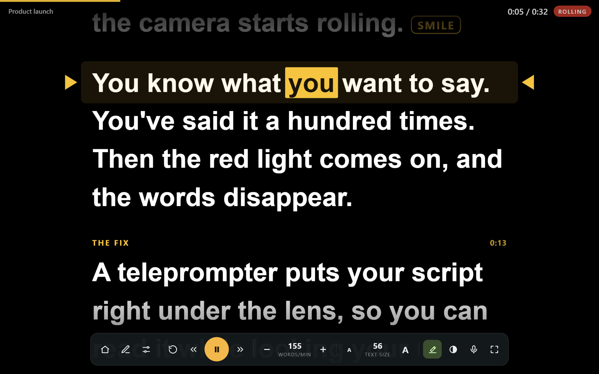
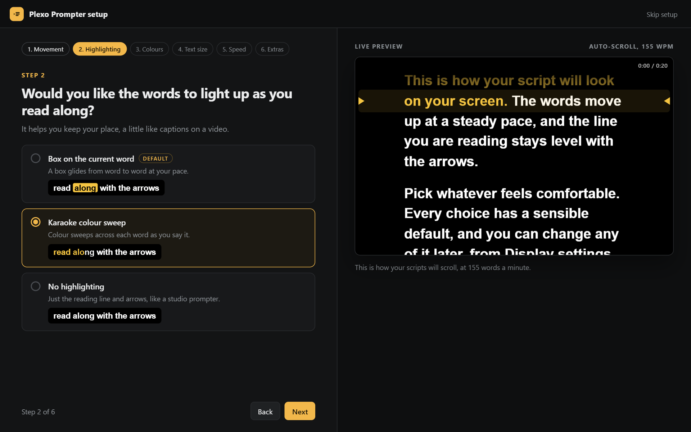
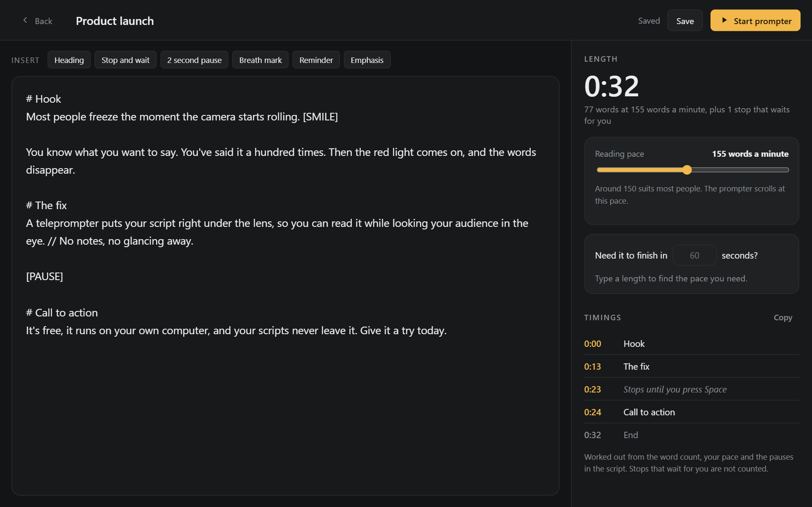
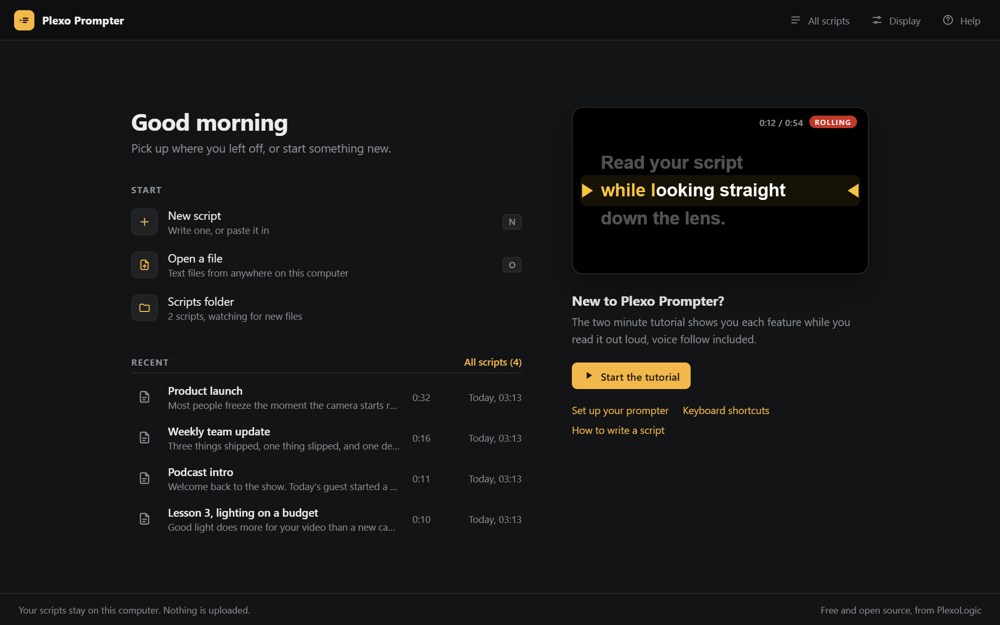
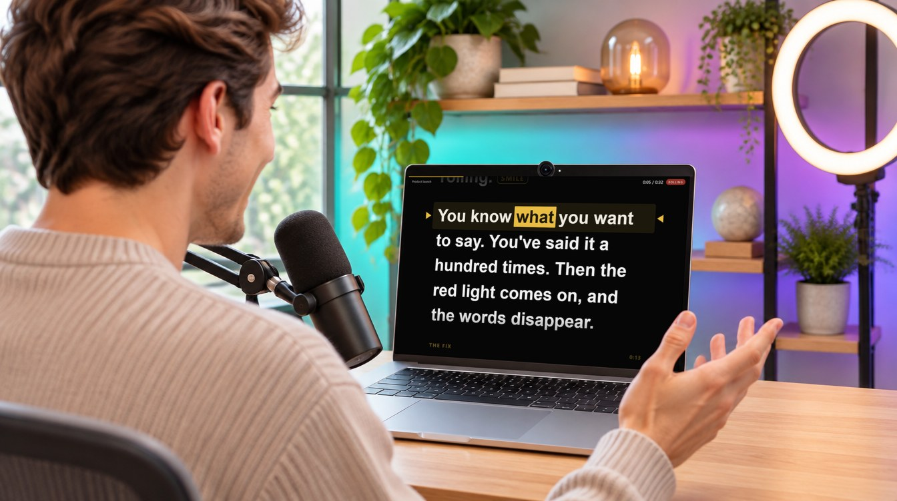

# Plexo Prompter

**A free teleprompter for your computer and phone.** Put your script under your camera, press play, and talk to camera like a pro.



Free and open source. No account, no subscription, and your scripts never leave your device.

**Try it now:** open [plexo-logic.github.io/plexo-prompter](https://plexo-logic.github.io/plexo-prompter/) in your browser, on a phone or a computer. There's nothing to install.

**Or run it on your computer,** as below, for a Scripts folder that updates as you save files. You need Chrome or Edge, and Python, a free program that the starter offers to install for you.

---

## Start on Windows

1. **Download.** At the top of this page, click the green **Code** button, then **Download ZIP**.
2. **Unzip.** In your Downloads folder, right-click the zip and choose **Extract All**.
3. **Start.** Open the Plexo Prompter folder and double-click **Start Plexo Prompter**. If Python isn't on your computer yet, it explains why it's needed and offers to install it for you, which takes about a minute.

The first time, Windows may ask if you're sure. Click **Run**, or **More info** then **Run anyway**.

## Start on Mac

1. **Download.** At the top of this page, click the green **Code** button, then **Download ZIP**, and double-click the zip to open it.
2. **Start.** Open the Plexo Prompter folder and double-click **Start Plexo Prompter**. If Python isn't on your Mac yet, it offers to download the official installer. Click through it, and the prompter starts by itself when it's done.

The first time, your Mac may say it can't check the file. Open **System Settings**, then **Privacy & Security**, scroll down and click **Open Anyway**. A small Terminal window opens with the prompter: leave it open while you record.

## Start on Linux

1. **Download** the ZIP (green **Code** button) and extract it. Python is usually already installed. If it isn't, the starter tells you the command to install it.
2. **Start.** Double-click **Start Plexo Prompter.sh** and choose **Run**. If it opens as text instead, right-click in the folder, choose **Open in Terminal**, type `python3 prompter_server.py` and press Enter.

**After that,** just double-click **Start Plexo Prompter** whenever you want to record, and close the prompter window when you're done.

## Use it on your phone

Open [plexo-logic.github.io/plexo-prompter](https://plexo-logic.github.io/plexo-prompter/) on your phone, then add it to your home screen:

- **iPhone (Safari):** tap the **Share** button, then **Add to Home Screen**.
- **Android (Chrome):** tap the **⋮** menu, then **Install app** (on some phones, **Add to Home screen**).

It opens like an app, works without a connection after the first visit, and keeps your scripts on your phone. Tap the text to start or pause, and drag to scroll. Filming with the front camera is on the way.

---

## Set up in a minute

A short setup asks how the text should move (auto-scroll, your voice, or a clicker), whether words light up as you read, and your colours, size and speed. The preview on the right shows your choices as you make them.



## Know your timings before you hit record

Paste or type a script and see how long it runs, and when every section starts. Need it in 60 seconds? It tells you the pace to read at.



## All your scripts in one place

Pick up recent scripts, search the library, or drop text files into the **Scripts** folder: they appear in the app within seconds.



## Look natural on camera



- **Put the prompter right under your webcam,** at the top of the screen.
- **Keep the column narrow,** so your eyes barely move.
- **Sit back a little.** Bigger text from further away keeps your gaze steady.
- **Read at your natural pace.** Around 150 words a minute suits most people.

---

## What it does

- **Three ways to scroll:** auto-scroll, voice follow (moves as you speak), or a presentation clicker
- **Word highlight:** a box that glides from word to word, or karaoke-style colour
- **Natural rhythm:** short pauses after commas, longer after full stops
- **Pauses, section headings and reminders** written straight into your script
- **Seven colour schemes** plus your own, mirror mode for glass rigs, countdown and timer

<details>
<summary><b>Writing a script</b></summary>

| Write this | And you get |
|---|---|
| A blank line | A new paragraph |
| `# Hook` | A small section heading, not read out |
| `[PAUSE]` on its own line | Stops until you press Space |
| `[PAUSE 2]` | A two second pause, then carries on |
| `//` | A breath mark, without stopping |
| `[SMILE]` | Any other words in square brackets show as a reminder |
| `*word*` | Emphasis |

Files are listed by name, so start names with `01`, `02` to set the order.
</details>

<details>
<summary><b>Keyboard shortcuts</b></summary>

| Key | Does |
|---|---|
| Space, Enter or Page Down | Start, pause, or carry on after a pause |
| Up / Down | Faster / slower (in clicker mode: previous / next line) |
| Left or Page Up / Right | Previous / next paragraph |
| Shift + Left / Right | Previous / next section |
| Home | Back to the start of the script |
| Esc | Pause, then back to the start screen |
| + / - and [ / ] | Text size and column width |
| K, T, M | Word highlight, colour scheme, mirror |
| F, V, H, S | Full screen, voice follow, hide controls, settings |

Presentation clickers work too. You can also scroll with the mouse wheel, or click a paragraph to jump to it.
</details>

<details>
<summary><b>Voice follow</b></summary>

Voice follow listens through your browser's speech recognition and keeps the next words on the reading line. On a computer it needs Chrome or Edge, and either the launcher or the online version; on a phone, Safari on an iPhone or Chrome on Android. It also needs an internet connection and your permission to use the microphone. While it's on, your browser sends the audio to its speech service (Google for Chrome, Microsoft for Edge). It's off until you switch it on.
</details>

<details>
<summary><b>Privacy and security</b></summary>

- Nothing is uploaded and nothing is tracked. The only internet use is your browser's speech service, while voice follow is on.
- The online version is the same app, served as plain files by GitHub Pages. It sends nothing back, and your scripts stay in your browser on your device.
- Saved scripts and settings stay in the browser on your computer.
- The launcher only answers your own computer and refuses requests from websites. It serves the app's files and nothing else, under a strict Content Security Policy.
- Script text is always treated as text, so a file can never run code in the app.
- If you keep private scripts, use the launcher rather than opening `app/index.html` directly: files opened from disk share their storage with other web pages saved on your computer.

Found a problem? Please open an issue.
</details>

<details>
<summary><b>Troubleshooting</b></summary>

- **"Plexo Prompter needs Python":** say yes when the starter offers to install it, or install it from [python.org](https://www.python.org/downloads/), then start it again.
- **Windows or Mac won't open the start file:** see the note under your system's steps above.
- **My saved scripts are missing:** they're kept in the browser you used. If a message said a port was busy, close the program using it and start again, and they'll be back.
- **Voice follow is greyed out:** use Chrome or Edge (Safari or Chrome on a phone), open the online version or start with the launcher, and allow the microphone.
- **No Python at all?** Use the [online version](https://plexo-logic.github.io/plexo-prompter/). Or open `app/index.html` in Chrome or Edge, where everything except voice follow works.
</details>

<details>
<summary><b>For developers</b></summary>

Plain HTML, CSS and JavaScript with no dependencies and no build step. The launcher is one Python file using only the standard library.

| File | What it does |
|---|---|
| `prompter_server.py` | The launcher: serves the app locally, lists the `Scripts` folder, opens the app window |
| `Start Plexo Prompter.*` | Double-click starters for Windows (`.bat`), Mac (`.command`) and Linux (`.sh`) |
| `app/index.html` | Every screen, plus the icons |
| `app/css/` | One stylesheet per screen, sharing `base.css` |
| `app/js/core.js` | Helpers, including `html`, the template that escapes everything it's given |
| `app/js/settings.js` | Every setting with its default and allowed values. Add a colour scheme here |
| `app/js/script.js` | Reads a script and works out its timing. Add a new marker here |
| `app/js/track.js` | Where each word sits on screen, and the maths between scroll position and time |
| `app/js/library.js` | Saved scripts, the Scripts folder and file import |
| `app/js/prompter.js` | Plays the script: scrolling, pauses, the timer and the controls |
| `app/js/highlight.js` | The box or karaoke fill on the word being read |
| `app/js/voice.js`, `follow.js` | Voice follow: listening, and working out where the reader is |
| `app/js/views.js` | Moves between screens and keeps the Back button working |
| `app/js/dialog.js` | The app's own confirm and rename dialogs |
| `app/js/home.js`, `browse.js`, `editor.js`, `setup.js`, `panel.js` | One file per screen: start, All scripts, editor, setup, settings |
| `app/js/preview.js` | Setup's live preview |
| `app/js/main.js` | Shortcuts, buttons, touch, drag and drop, and start-up |

Each file adds one part to a single `Plexo` object. Settings and the library announce their changes, and each screen redraws itself when they do. `script.js`, `track.js` and `follow.js` never touch the page, so the tricky parts (timing, scrolling maths and voice matching) are tested directly in Node. `build.py` bundles the sample scripts, including both tutorials, into `app/js/samples.js`.

Tests need Node 18+ and Python 3.8+, and GitHub runs them on every push, publishing the app only when they pass:

```
node --test tests/
python -m unittest discover tests
```
</details>

## Licence

MIT. Free to use, change and share. Made by PlexoLogic.
